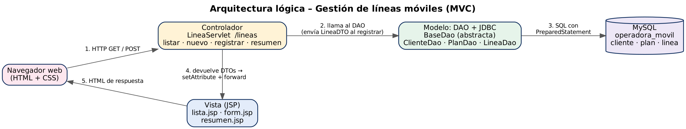
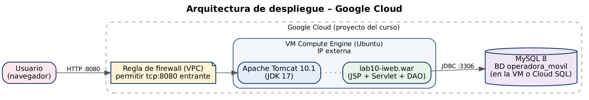

# Lab 10 (simulacro) – Gestión de líneas móviles · TEL131

Aplicación web MVC (JSP + Servlet + DTO + DAO + JDBC) para registrar líneas móviles,
asignarlas a un cliente y a un plan, y consultar el resumen de ingresos por plan.

**Alumno:** Alvaro Pimentel Melgar · 20232283

## Requisitos

- JDK 17
- Apache Tomcat 10.1
- MySQL 8

## Ejecución local

1. Ejecutar `db/operadora_movil.sql` en MySQL.
2. En `BaseDao.java`, colocar el usuario y la contraseña de MySQL.
3. Desplegar en Tomcat con el *context path* `/lab10-iweb`.
4. Ingresar a `http://localhost:8080/lab10-iweb/lineas`.

## Estructura

```
db/operadora_movil.sql
docs/                                  diagramas de arquitectura (Ejercicio 5)
src/main/java/org/example/lab10_iweb/
  dto/       ClienteDTO, PlanDTO, LineaDTO, ResumenPlanDTO
  dao/       BaseDao (abstracta), ClienteDao, PlanDao, LineaDao
  servlets/  LineaServlet                /lineas
src/main/webapp/
  lista.jsp · form.jsp · resumen.jsp · css/estilos.css
```

## URLs

| Método | URL                       | Qué hace                    |
|--------|---------------------------|-----------------------------|
| GET    | `/lineas`                 | Listado de líneas           |
| GET    | `/lineas?action=nuevo`    | Formulario de registro      |
| GET    | `/lineas?action=resumen`  | Resumen por plan            |
| POST   | `action=registrar`        | Valida e inserta una línea  |

## Arquitectura





## Despliegue en la nube

**URL pública:** `http://<IP_EXTERNA>:8080/lab10-iweb/lineas` <!-- completar después de desplegar -->

### Pasos realizados (Google Cloud – Compute Engine)

1. Se creó una VM en Compute Engine (Ubuntu, e2-small) con IP externa.
2. Se creó la regla de firewall `allow-tomcat-8080` (entrada, `tcp:8080`).
3. En la VM (por SSH) se instalaron JDK 17 y MySQL, y se descargó Tomcat 10.1.
4. Se ejecutó `db/operadora_movil.sql` en el MySQL de la VM.
5. Se generó el `.war` con Maven (`package` → `target/lab10-iweb.war`), se subió a la VM
   y se copió a `apache-tomcat-10.1.x/webapps/`.
6. Se inició Tomcat con `bin/startup.sh`.
7. Para cambiar de entorno solo se modificaron las constantes `URL`, `USER` y `PASS` de `BaseDao`.

### Evidencia

<!-- Agregar captura: docs/captura_nube.png -->


### Costos estimados (3 meses)

Estimación tomada de los valores de referencia de la Clase 10.1 (Gestión de Costos).

| Recurso                      | Costo mensual (USD) | 3 meses (USD) |
|------------------------------|--------------------:|--------------:|
| Máquina virtual (EC2 / Compute Engine) | 80.00     | 240.00        |
| Base de datos (RDS / Cloud SQL)        | 50.00     | 150.00        |
| **Subtotal**                           | **130.00**| **390.00**    |
| Imprevistos (20 %)                     |           | 78.00         |
| **Total estimado**                     |           | **468.00**    |
